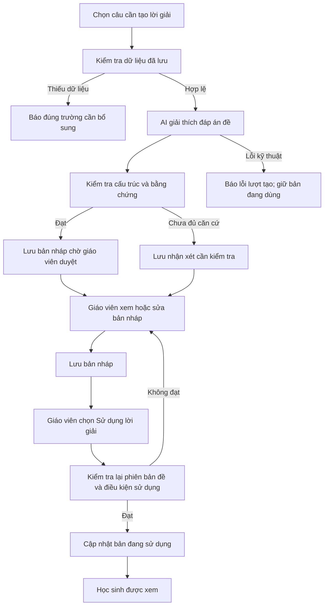

# Đề xuất thống nhất chức năng AI giải thích Reading/Listening

Ngày rà soát: 2026-11-14. Phạm vi: Test và Practice, cả Reading và Listening. **Trạng thái: đề xuất để xem xét; chưa triển khai.** Phiên này chỉ đọc code/cấu hình và lập tài liệu; không sửa ứng dụng, commit, deploy, chạy sinh AI hoặc ghi dữ liệu thật.

## 1. Yêu cầu đã được người dùng xác nhận

1. AI giải thích đáp án đã có trong đề; khi thiếu bằng chứng phải báo rõ, không tự đổi đáp án.
2. Lời giải AI mới chỉ được hiển thị cho học sinh sau khi giáo viên xác nhận sử dụng.
3. Một luồng chung cho bốn màn hình, tối ưu và tối giản; không tiếp tục vá từng thông báo độc lập.
4. Mở lại bài là một phiên thao tác mới, không dựng lại màn hình tiến trình cũ. Nội dung đã lưu và việc khôi phục tiến trình là hai việc riêng.

Các phần kiến trúc, API, lưu trữ và lộ trình bên dưới là đề xuất của người rà soát, chưa phải quyết định triển khai đã được phê duyệt.

## 2. Đối chiếu hiện tại và đề xuất

| Hạng mục | Hiện tại, theo code | Hạn chế / ảnh hưởng | Đề xuất |
| --- | --- | --- | --- |
| Nhiệm vụ của AI | Lượt tạo mặc định cho AI tự giải; có nhánh giải thích đáp án cố định và nhánh giải mù kiểm chứng. | Trộn hai sản phẩm: giải thích đáp án và kiểm định đáp án. Sinh thêm xung đột, lượt gọi và thao tác. | Mặc định chỉ giải thích đáp án đề. Kiểm định đáp án là một chức năng riêng, không chạy ngầm. |
| Thay đổi đáp án | Chỉ nhánh giáo viên chọn AI mới cập nhật đáp án; hiện không phải AI tự ý đổi mọi đáp án. | Thao tác đổi đáp án vẫn nằm trong quy trình tạo lời giải. | API tạo/lưu/sử dụng lời giải không có quyền ghi đáp án. Muốn đổi đáp án phải vào chỉnh sửa đề và xác nhận riêng. |
| Ai được xem | Bộ lọc cho học sinh chấp nhận `ai_generated`, `teacher_reviewed`, `teacher_edited`. | Tạo AI hoặc lưu sửa có thể làm lời giải xuất hiện mà không có bước xác nhận sử dụng riêng. Không đáp ứng chính sách mới. | Chỉ trả bản giáo viên đã xác nhận sử dụng và còn phù hợp phiên bản đề. |
| Bản mới và bản cũ | Một trường JSON lời giải cho mỗi câu; Practice bọc theo `byNumber`. | Chưa có nơi lưu riêng bản mới chờ duyệt và bản đang dùng. Tạo lại có thể thay bản AI đã lưu. | Bản nháp tách khỏi bản đang dùng; tạo lại không đè bản đang dùng. |
| Lưu và duyệt | Đã có API sửa tay và API duyệt riêng; sửa tay gán `teacher_edited`, bản này được phép hiển thị cho học sinh. | “Lưu” và “cho học sinh sử dụng” chưa tách hẳn. | Hai thao tác rõ: **Lưu bản nháp** và **Sử dụng lời giải**. Cả hai không gọi AI. |
| Nội dung đầu vào | Có passage/transcript, câu hỏi, options, ảnh. Một số nhánh Listening cho phép dùng `context` hoặc passage thay transcript. | Mô tả bối cảnh không bảo đảm chứa lời nói thực tế cần làm bằng chứng. | Reading cần passage; Listening cần transcript. Câu bản đồ/sơ đồ cần thêm ảnh. Audio đơn lẻ chưa đủ cho luồng này. |
| Căn cứ trả lời | Đã kiểm tra trích dẫn có trong nguồn và có cơ chế `no_support`. | Trích dẫn tồn tại không tự chứng minh lập luận đúng; nhiều nhánh hiện vẫn kiểm tra bằng giải mù/fallback. | Giữ kiểm tra trích dẫn, cấu trúc, đáp án và giới hạn từ; chặn nội dung không đủ căn cứ; giáo viên quyết định sử dụng. Không dùng điểm tự tin của AI để tự duyệt. |
| Tốc độ | Gemini trên server đang cấu hình 12 lượt/phút; hàng đợi chạy tuần tự. Có retry provider, sửa đầu ra và kiểm chứng lại khi fallback lệch đáp án. | Nhiều lớp gọi làm thời gian tăng mạnh. Với 38 lượt độc lập, riêng nhịp 12/phút đã tạo mốc lý thuyết khoảng 185 giây từ lượt đầu đến lượt cuối, chưa tính các chờ khác. | Giảm số lượt gọi, giới hạn tổng số lần thử ở một nơi; dừng sớm khi provider quá tải; không tăng RPM khi chưa xác minh quota. |
| Tiến trình | Trình duyệt nối các request có ngân sách thời gian; đã hủy khi rời trang và không khôi phục màn hình tiến trình cũ. | Logic điều phối và trạng thái còn lặp ở bốn editor; sửa một nơi dễ lệch nơi khác. | Một bộ điều phối UI, một pipeline backend; adapter chỉ chuyển dữ liệu Test/Practice. Giữ phiên UI mới khi mở lại. |
| Đếm đã lưu | `generatedCount` tăng trước transaction. Transaction có thể bỏ qua câu được bảo vệ hoặc vừa thay đổi. | Có nguy cơ báo số đã lưu cao hơn số thực ghi trong các nhánh bỏ qua. Đây là rủi ro xác định từ code, chưa tái hiện bằng ghi dữ liệu thật trong lần rà soát này. | Trả số ghi thành công sau commit, cùng kết quả từng câu: đã lưu / bỏ qua / lỗi. |
| Trạng thái | Có trạng thái nội dung, lỗi lượt gọi, nhãn bảo vệ, bản nháp UI và báo cáo; đã thống nhất một phần nhãn. | Đổi nhãn không xử lý triệt để việc đang trộn trạng thái tạo, chất lượng và sử dụng. | Tách ba trục ở dữ liệu; giao diện chỉ hiện nhãn và hành động cần thiết. |
| Đồng thời / dữ liệu thay đổi | Có khóa trong bộ nhớ, timestamp, bảo vệ lời giải giáo viên sửa và đánh dấu stale ở một số đường lưu. | Khóa không bền qua restart; timestamp không thay thế việc đối chiếu toàn bộ đầu vào. Số câu Practice cũng có thể đổi khi sắp xếp lại. | Kiểm tra phiên bản nguồn ở backend khi lưu/duyệt; định danh ổn định cho câu Practice; chống request lặp và bản trả về muộn. |
| Chẩn đoán | Đã có mã lỗi, provider/model, thời điểm, phase và timeout ở một số nhánh. | Chưa có một hợp đồng kết quả và phép đo xuyên suốt để phân biệt chờ quota, sinh, kiểm tra, ghi DB. | Một mã lượt thao tác, thời gian từng bước, số lần gọi thực và kết quả commit; không ghi API key hoặc toàn bộ nội dung đề vào log. |

### Bằng chứng code chính

- `backend/services/explanationGeneratorService.js:169`: điều kiện học sinh được xem; `:867` và `:1334`: hai đường xử lý Practice/Test; `:1031` và `:1582`: xác nhận dùng lại preview đã lưu; `:1077` và `:1632`: đếm trước commit; `:1230` và `:1805`: ghi và bỏ qua trong transaction; `:2665`: sửa tay; `:2822`: duyệt.
- `backend/scripts/generate-explanations.js:412`: dựng nguồn Reading/Listening; `:447`: hai kiểu prompt; `:747`: schema; `:869` và `:950`: gọi provider và vòng sửa đầu ra.
- `backend/scripts/import-practice-explanations.js`: adapter câu Practice; `backend/prisma/schema.prisma:95`, `:409`: hai dạng lưu câu hỏi.
- `backend/lib/geminiRateLimiter.js`, `backend/lib/explanationLock.js`, `backend/lib/requestAbort.js`: nhịp gọi, khóa và hủy.
- `frontend/src/utils/examExplanationUtils.js:495`, `frontend/src/hooks/useExplanationGenerationLock.js`: điều phối request và vòng đời phiên hiện tại.
- Cấu hình server được đọc riêng bằng danh sách biến cho phép: `GEMINI_MODEL=gemini-3.5-flash-lite`, `GEMINI_MAX_RPM=12`. Không đọc/in giá trị API key.

## 3. Luồng thống nhất được đề xuất

### Bước 1 — Chuẩn bị

- Phạm vi: câu chưa có lời giải, một nhóm hoặc các câu giáo viên chọn. Mặc định không tạo lại các câu đã có bản đang dùng.
- Nếu đề có chỉnh sửa chưa lưu, yêu cầu thao tác rõ **Lưu đề & tạo lời giải**; không âm thầm tạo theo một bản CSDL khác với nội dung đang nhìn.
- Kiểm tra đúng passage/transcript, đáp án, loại câu, lựa chọn, yêu cầu số từ và ảnh liên quan. Hiển thị thiếu gì ở đúng câu; không gửi yêu cầu AI chắc chắn thiếu dữ liệu.
- Lấy bản đầu vào đã lưu và tạo dấu vân tay nguồn, gồm cả nội dung, đáp án, options, instruction và phiên bản ảnh. Các câu không hợp lệ không ngăn câu độc lập hợp lệ được tạo.

### Bước 2 — AI tạo bản nháp

- Gửi đáp án đề như một giá trị cố định. AI trả bằng chứng và diễn giải hoặc kết luận không đủ căn cứ; mọi đáp án khác chỉ là nhận xét cần kiểm tra, không thành một lựa chọn tự động sửa đề.
- Giữ cách trình bày bốn bước đang có nhưng rút ngắn nội dung: phân tích câu hỏi → tìm vị trí → trích bằng chứng → giải thích đáp án/loại phương án sai.
- Bộ máy không cố tạo dẫn chứng cho đáp án không được nguồn hỗ trợ.
- Lưu bản nháp ở server sau mỗi đơn vị hoàn tất. Nếu lưu lỗi, có thể thử lưu lại kết quả đang có khi còn hiệu lực; không bắt giáo viên trả chi phí gọi AI lại chỉ vì DB chậm.

### Bước 3 — Kiểm tra theo dạng câu

| Dạng | Kiểm tra bắt buộc |
| --- | --- |
| Điền từ / trả lời ngắn | Đúng đáp án, giới hạn từ/số, ngữ pháp câu điền và trích dẫn thực tế. |
| Trắc nghiệm / chọn nhiều | Đúng tập lựa chọn và số lượng cần chọn; lý do loại phương án sai dựa trên nguồn. |
| Matching / headings | Đúng danh sách lựa chọn, đoạn tương ứng và quy tắc được/không được dùng lại. |
| True/False/Not Given | Phân biệt mâu thuẫn với không có thông tin. NOT GIVEN có thể không có trích dẫn khẳng định; không ép AI bịa một câu làm bằng chứng cho sự vắng mặt. |
| Bản đồ / sơ đồ | Có ảnh và nguồn đủ để giải thích; không dùng provider không đọc ảnh cho câu cần thị giác. |
| Listening | Trích đúng transcript, giải thích cách diễn đạt lại/bẫy sửa ý khi có trong nguồn. Chỉ dùng mốc audio khi đã có dữ liệu thời gian thật; không tự bịa timestamp. |

Các kiểm tra tự động chỉ xác nhận những gì máy kiểm tra được. Lập luận có thật sự thuyết phục vẫn cần giáo viên duyệt.

### Bước 4 — Giáo viên xem và lưu

- Bản đạt điều kiện: **Chờ duyệt**. Bản không đủ căn cứ: **Cần kiểm tra**, kèm một lý do và một hành động cụ thể.
- **Lưu bản nháp** chỉ lưu nội dung giáo viên sửa; chưa thay lời giải học sinh đang thấy.
- Nếu thay đáp án hoặc nội dung đề, thực hiện trong phần sửa đề. Hệ thống đánh dấu bản nháp/lời giải liên quan cần kiểm tra lại; không âm thầm chuyển sang đáp án AI.
- Giáo viên được sửa một bản bị đánh dấu thiếu bằng chứng, nhưng chỉ được sử dụng sau khi giải quyết các điều kiện bị chặn. Nếu xác nhận ngoại lệ về mặt chuyên môn, cần ghi nhận lý do; không cho vượt kiểm tra nguồn/đáp án bằng một nút duyệt chung chung.

### Bước 5 — Xác nhận sử dụng

- Nút **Sử dụng lời giải** là bước riêng, không gọi AI.
- Backend đối chiếu lại đáp án, dấu vân tay nguồn, phiên bản bản nháp và quyền giáo viên; lưu nguyên bản đã được xem/sửa.
- Chỉ sau transaction thành công mới cập nhật UI và báo **Đã cập nhật lời giải cho học sinh**.
- Nếu chỉ lưu nháp: báo **Đã lưu bản nháp**. Không dùng một thông báo cho cả hai nghiệp vụ.
- Khi có bản đang dùng và giáo viên tạo lại với cùng nội dung đề, học sinh tiếp tục xem bản cũ cho đến khi bản mới được sử dụng.
- Khi nội dung/đáp án nguồn đã thực sự thay đổi và khiến bản cũ không còn phù hợp, không tiếp tục phát bản cũ như thể vẫn đúng; đánh dấu cần duyệt lại ở server.

### Bước 6 — Dừng / rời trang / lỗi

- Dừng không tạo thêm câu; hủy yêu cầu đang chạy khi có thể. Những bản nháp đã commit trước khi dừng vẫn được giữ. Không hứa hủy có thể đảo ngược dữ liệu đã commit.
- Mở lại: UI mới, không khôi phục thanh tiến trình. Các bản nháp đã lưu vẫn là nội dung bình thường và có thể mở xem.
- Lỗi kỹ thuật chỉ thuộc lượt tạo/lưu đó, không ghi đè trạng thái bản đang dùng.
- Thử lại chỉ áp dụng câu đã chọn. Nhận biết request đã commit nhưng mất phản hồi để không sinh hoặc lưu trùng.
- Một tab khác thực sự đang ghi cùng câu vẫn được backend bảo vệ; không mở khóa bằng cách bỏ qua kiểm tra server.

## 4. Giao diện tối giản

Ngoài danh sách câu, chỉ cần một nút **Tạo lời giải AI** và một dòng tiến độ khi đang chạy. Phạm vi chọn ở một nơi, không đồng thời đặt nhiều nút tạo lại cho cùng việc.

Nhãn nội dung dùng thống nhất: **Chưa có · Chờ duyệt · Cần kiểm tra · Đang sử dụng**. Khi vừa có bản đang dùng vừa có bản mới chờ duyệt, nhãn chỉ việc đang cần làm; trong câu ghi rõ học sinh vẫn xem bản cũ. Lỗi timeout/DB nằm ở kết quả lượt thao tác, không biến thành một trạng thái chất lượng lời giải.

Trong câu: đáp án đề, một khối lý do nếu cần xử lý, nội dung lời giải, và hành động phù hợp. Nếu có hai phiên bản, cho xem **Đang sử dụng / Bản mới**, không đặt hai lời giải dài cạnh nhau trên mobile.

Thông báo chỉ một lần cho mỗi hành động hoàn tất. Lỗi hàng loạt gom thành số câu; mở câu mới xem nguyên nhân. Không mở liên tiếp popup cho từng câu. Phần cần kiểm tra tiếp tục dùng danh sách số câu gọn.

## 5. So sánh ba phương án kiến trúc

| Phương án | Ưu điểm | Điểm yếu | Đánh giá |
| --- | --- | --- | --- |
| A. Tiếp tục sửa trên luồng hiện tại | Ít thay đổi ban đầu. | Vẫn trộn tự giải/giải thích, lưu/phát hành và nhiều bộ trạng thái. | Không đáp ứng triệt để yêu cầu đã chốt. |
| B. Một pipeline, tách bản nháp/bản dùng; xử lý request nhỏ | Đồng bộ bốn màn hình, tái sử dụng phần kiểm tra tốt, phù hợp server hiện tại và phiên mới khi mở lại. | Cần thiết kế phiên bản và chuyển đổi dữ liệu cũ cẩn thận. | **Đề xuất cho giai đoạn đầu.** |
| C. Job nền bền vững và hàng đợi riêng | Hợp chạy nền dài, nhiều giáo viên, quy mô lớn. | Tăng hạ tầng/vận hành, chính sách hủy/khôi phục và độ phức tạp. Không tự làm model nhanh hơn. | Chỉ cân nhắc sau khi số đo thực tế chứng minh cần. |

### Thành phần tối thiểu cho phương án B

1. **Adapter Test/Practice**: đưa về một dữ liệu câu thống nhất; Reading/Listening khác nguồn và quy tắc kiểm tra, không khác quy trình lưu/duyệt.
2. **Dịch vụ chung**: kiểm tra đầu vào → dựng prompt cố định đáp án → gọi provider → kiểm tra kết quả → lưu bản nháp.
3. **Dịch vụ sử dụng lời giải**: kiểm tra phiên bản → ghi bản đã duyệt → làm mới cache cho học sinh. Không gọi provider.
4. **Bộ điều phối giao diện chung**: tiến độ, dừng, thử lại, phản hồi lưu. Bốn trang chỉ truyền dữ liệu/adapter.
5. **Nơi lưu bản nháp riêng**: đề xuất bảng nhỏ chuyên biệt có target ổn định, payload, source hash, draft version, validation issue, metadata và thời gian. Giữ payload lời giải hiện tại để tái sử dụng bộ hiển thị. Bản đang sử dụng được ghi/cập nhật nguyên tử qua adapter và có metadata người duyệt/phiên bản.

Không đề xuất normalize lại toàn bộ dữ liệu Practice hay bổ sung Redis ở bước đầu. Tuy nhiên phải xử lý định danh câu Practice trước khi dựa vào bản nháp: số thứ tự câu chỉ để hiển thị, không làm định danh duy nhất sau khi chuyển/sắp xếp nhóm. Có thể thêm ID ổn định trong JSON hiện có; kế hoạch chuyển đổi cần dry-run và xác nhận trước mọi ghi dữ liệu thật.

## 6. Tối ưu cụ thể và cách đo

- Tái sử dụng bộ kiểm tra trích dẫn, chuẩn hóa đáp án, bảo vệ lời giải giáo viên và xử lý hủy hiện có.
- Một nơi sở hữu retry. Đề xuất tối đa hai lượt gọi provider cho một lần tạo/câu: lượt chính và một lượt thử lại hoặc dự phòng, dùng chung ngân sách thời gian. Tránh SDK retry ngầm làm vượt ngân sách này.
- Không giải mù kiểm chứng tất cả câu trong luồng giải thích mặc định. Chỉ mở kiểm định đáp án như thao tác riêng nếu sau này cần.
- Tạm bỏ qua provider đang lỗi liên tiếp theo một khoảng chờ cấu hình; không liên tục quay lại provider vừa quá tải sau mỗi fallback.
- Giữ đầu ra có cấu trúc, giới hạn độ dài từng trường, bỏ phần không áp dụng với loại câu. Không gửi một yêu cầu sinh JSON rất dài cho cả đề 38 câu.
- Dùng chung ngữ cảnh đã chuẩn hóa trong nhóm. Khởi đầu mỗi kết quả vẫn nhận diện riêng từng câu; chỉ gộp vài câu/nhóm ảnh sau khi đo được chất lượng, độ trễ và khả năng tách lỗi từng câu.
- Khi chỉ DB lỗi, tách việc thử lưu khỏi gọi AI. Khi chỉ sử dụng bản nháp đã có, không gọi AI.
- Phản hồi gồm kết quả từng câu và số **đã commit**, không suy ra từ số AI vừa sinh. Khóa bản nháp/phiên bản và operation ID ngăn ghi trùng hoặc kết quả cũ đè bản mới.
- Đo queue wait, provider time, validation time, DB commit time; số lần gọi/câu; p50/p95; tỷ lệ thiếu căn cứ; tỷ lệ giáo viên phải sửa. So sánh trước/sau trên cùng bộ câu mẫu.

Chưa cam kết một mức thời gian tạo cả đề khi chưa có benchmark và quota thực tế. Tăng số request đồng thời hoặc đổi model không thay thế việc giảm số lần gọi và sửa luồng.

## 7. Kế hoạch triển khai có điểm kiểm tra

| Giai đoạn | Đầu ra | Điều kiện đi tiếp |
| --- | --- | --- |
| 1. Chốt đặc tả | Luồng, hợp đồng dữ liệu/API, định nghĩa lưu nháp/sử dụng, bảng trạng thái và bộ câu mẫu. | Người dùng duyệt luồng; các tình huống mẫu có kết quả kỳ vọng rõ. |
| 2. Nền tảng bản nháp/phiên bản | Adapter chung, định danh ổn định, lưu nháp tách bản dùng, kiểm tra source hash, idempotency và hợp đồng kết quả commit. | Tạo/lưu không sửa đáp án; mất phản hồi không gây bản trùng; bản đang dùng không bị ghi đè. |
| 3. Pipeline giải thích | Prompt theo đáp án đề, validation theo loại câu, giới hạn retry và đo thời gian. | Đầu vào thiếu bị chặn đúng; bằng chứng giả bị từ chối; NOT GIVEN hợp lệ không bị ép có quote. |
| 4. Duyệt và giao diện chung | Một bộ UI cho bốn trang, lưu nháp/sử dụng tách biệt, đúng số đã lưu, thông báo tối giản. | Lưu/sử dụng không gọi AI; bản chưa duyệt không đến học sinh; lỗi một câu không làm mất kết quả khác. |
| 5. Kiểm thử và chuyển đổi | Test chức năng, bộ câu giáo viên đánh giá, so sánh hiệu năng, security review, dry-run dữ liệu cũ và rollback. | Kết quả kiểm thử đạt; chính sách dữ liệu cũ được chốt trước khi ghi; chỉ deploy sau khi người dùng đồng ý triển khai. |

Không ấn định số ngày ở bước rà soát này. Ước lượng sau khi chốt dữ liệu cũ, cách lưu bản nháp và số dạng câu cần đưa vào bản đầu.

### Bộ tình huống bắt buộc

1. Tạo mới câu đủ dữ liệu; câu thiếu transcript; map thiếu ảnh; matching thiếu options; completion vượt số từ.
2. AI trả đúng schema nhưng trích dẫn không có thật; trích dẫn có thật nhưng không ủng hộ đáp án; NOT GIVEN không có quote khẳng định.
3. Model 503/429/timeout/JSON lỗi; fallback; DB lỗi sau khi AI đã trả; mất phản hồi sau commit.
4. Lưu bản nháp, sửa bản nháp, sử dụng bản nháp: kiểm tra số lượt AI không tăng ở các thao tác lưu/duyệt.
5. Học sinh không đọc được bản chưa duyệt qua Test, Practice, API kết quả hay chatbot; cache không trả bản cũ sai chính sách.
6. Có bản đang dùng, tạo bản mới rồi lỗi/hủy: bản cũ còn nguyên nếu nguồn chưa đổi. Đổi đáp án/nguồn: bản cũ không được tiếp tục dùng như bản hợp lệ.
7. Hai tab, sửa nguồn trong khi AI chạy, di chuyển/đánh số lại câu Practice, lưu câu khác đồng thời và sửa tay lời giải đã bảo vệ.
8. Dừng/rời trang/mở lại: phiên UI mới; bản nháp đã lưu còn xem được; kết quả trả muộn không đè phiên mới.
9. Đồng bộ bốn editor; desktop/mobile/bàn phím; không có nhãn chưa lưu sau khi server đã xác nhận đúng phiên bản.

## 8. Dữ liệu cũ và các điểm cần chốt trước khi code

- Chưa tự chuyển hàng loạt trạng thái hay ẩn lời giải đang hiển thị. Cần thống kê chỉ đọc và chốt cách phân loại dữ liệu cũ theo người đã duyệt, trạng thái và chất lượng. Các bản AI cũ chưa có dấu duyệt không được mặc nhiên gán là giáo viên đã duyệt.
- Chốt bản đầu chỉ duyệt từng câu hay thêm duyệt các câu đã chọn sau khi giáo viên đã xem. Không có nút tự duyệt mọi kết quả chỉ vì kiểm tra tự động đạt.
- Chốt cách tạo ID ổn định cho câu Practice, bảng nháp và phương án tương thích với JSON lời giải hiện tại. Không coi số câu là một khóa bền vững.
- Chốt thời gian lưu lịch sử bản nháp và mức chi tiết cần giữ; không xây lịch sử vô hạn nếu không có nhu cầu.

## 9. Phản biện thiết kế

| Góc nhìn | Rủi ro | Cách khống chế trong đề xuất |
| --- | --- | --- |
| Kiến trúc | Lập thêm nhiều dịch vụ/hạ tầng cho project một người. | Giữ Express/PostgreSQL hiện tại, adapter chung và một pipeline; chưa thêm hàng đợi nền. |
| Bảo mật/dữ liệu | Bản nháp bị lộ qua một đường đọc phụ; prompt từ nội dung đề dẫn dắt model. | Tách dữ liệu nháp, kiểm soát quyền ở backend, kiểm tra mọi đường học sinh/chatbot; coi passage/transcript là dữ liệu, không là chỉ dẫn; không thực thi đầu ra AI. |
| Hiệu năng | Retry/call kiểm chứng làm lời giải lâu dù đổi giao diện. | Một ngân sách retry, đầu ra ngắn, đo từng bước, không giải mù mặc định và không tăng quota tùy tiện. |
| UX | Có bản nháp được lưu nhưng người dùng tưởng học sinh đã thấy. | Tên nút/thông báo riêng cho lưu nháp và sử dụng; trong câu chỉ rõ phiên bản học sinh đang xem. |
| Phản biện | Ép đáp án đề có thể khiến AI hợp thức hóa đáp án sai. | Bắt buộc cho phép thiếu/mâu thuẫn bằng chứng, không tự duyệt, không bịa quote; đổi đáp án là thao tác giáo viên riêng. |

Kết luận phản biện: phương án B phù hợp để tiếp tục **đặc tả**, chưa phải lệnh triển khai. Các quyết định dữ liệu cũ và kiểm soát xuất bản phải được giải quyết trước khi đổi schema hoặc phát hành.

## 10. Quyết định triển khai đã được duyệt (2026-11-15)

Người dùng đã yêu cầu triển khai và chọn giữ bản cũ đang hiển thị; mọi bản AI mới phải được giáo viên xác nhận sử dụng. Luồng chung cho Reading/Listening, Test/Practice: **Tạo nháp → Lưu bản nháp → Sử dụng lời giải**. Hai thao tác sau không gọi AI. AI chỉ giải thích đáp án đã lưu; đổi đáp án thuộc phần sửa đề.

Để giảm phạm vi chuyển đổi dữ liệu, bản đầu dùng envelope JSON `workflowVersion: 3` trong cột lời giải hiện có, chứa riêng `published` và `draft`, thay cho bảng nháp mới dự kiến. Chỉ chuyển cấu trúc khi giáo viên thao tác với câu; không migration/backfill dữ liệu thật. Bản cũ được giữ nguyên làm bản đang dùng, không gán nhãn đã được giáo viên duyệt. Chưa cung cấp lịch sử phiên bản vô hạn.

Mỗi bản nháp có version và hash nguồn; lưu/duyệt kiểm tra lại trong transaction. Thao tác sửa nguồn và lời giải dùng chung advisory lock theo bài, chỉ giữ khóa trong lúc đọc/ghi DB. Nguồn hoặc đáp án thay đổi khiến lời giải cũ cần kiểm tra lại. Practice bổ sung ID ổn định khi ghi lời giải và kiểm tra ID trùng khi sửa đề.

API học sinh chỉ nhận bản đang dùng; dữ liệu nháp và metadata nội bộ được loại khỏi cả JSON câu Practice. Giao diện mở lại bắt đầu phiên tiến trình mới, vẫn đọc được các bản nháp đã lưu. Lỗi kỹ thuật và vấn đề bằng chứng được tách biệt; chỉ đếm câu đã commit thành công.

Mỗi câu có giới hạn thời gian gọi AI; Gemini không tự retry nhiều model, chỉ fallback Groq một lần với lỗi 429/5xx và đầu vào không có ảnh. `operationId` chống gọi lại khi gửi lại cùng lượt đã commit. Giới hạn hiện tại: người dùng chủ động tạo lại sau lỗi mạng là một lượt mới; cần tải lại dữ liệu để kiểm tra bản đã lưu trước khi tạo lại. Kiểm tra trích dẫn tự động không thay thế đánh giá ngữ nghĩa của giáo viên.

Kiểm chứng: backend 1.211 test đạt (64 bài kiểm tra DB được bỏ qua ở suite mặc định); frontend 1.002 test đạt. Chromium kiểm tra bốn editor ở 390px và 1440px, 8/8 trường hợp đạt. ESLint phần frontend thay đổi không có lỗi; toàn repo còn lỗi lint cũ ngoài phạm vi. Kiểm tra PostgreSQL tách biệt và smoke sau deploy được ghi trong bằng chứng release, không chạy thao tác tạo lời giải trên dữ liệu thật để kiểm thử.

PostgreSQL 16 tách biệt: cả bốn tổ hợp Test/Practice × Reading/Listening đạt với Prisma thật; kiểm tra JSON compare-and-swap, đúng phiên bản được duyệt, giữ đáp án, không gọi AI khi lưu/duyệt, và chờ khóa nguồn rồi từ chối `SOURCE_CHANGED`. Provider giả lập, không có lượt gọi AI thật; DB/container kiểm thử dùng mạng riêng không mở cổng host. Script tái hiện: `backend/scripts/smoke-explanation-workflow-isolated.js`, chặn chạy nếu URL không trỏ đúng DB kiểm thử.

## 11. Rà soát nội dung theo dạng câu (hotfix)

- Note/Form/Table/Sentence/Summary/Flow-chart Completion, Short Answer và điền từ tự do: không sinh, lưu hoặc hiển thị “Những lựa chọn còn lại”. Không biến từ trong passage/transcript thành lựa chọn giả.
- MCQ một/nhiều đáp án, Matching, Word Bank và hình/bản đồ có ngân hàng đáp án: chỉ phân tích lựa chọn thật của đề, loại đáp án đúng khỏi danh sách bị loại. True/False/Not Given và Yes/No/Not Given dùng tập lựa chọn cố định; chuẩn hóa cả đáp án viết tắt.
- Dữ liệu cũ được chuẩn hóa khi đọc, không ghi đè hàng loạt. Giao diện xem và sửa cùng dùng ngữ cảnh dạng câu/nhóm và ngân hàng lựa chọn.
- “Chờ duyệt” là bản nháp hợp lệ, không nằm trong danh sách lỗi “Cần kiểm tra”. Câu có xung đột hiển thị đáp án đề và đáp án trong lời giải AI; sửa lời giải hoặc quay lại sửa đề, còn tạo lại theo đáp án đề là thao tác riêng. AI không tự sửa đáp án đề.
- Bốn editor dùng chung một mục “Cần kiểm tra lời giải”: hợp nhất trạng thái đã lưu và lỗi lượt chạy theo số câu, không đếm trùng. Bỏ báo cáo kết thúc riêng cùng các dòng tổng kết lặp; chỉ giữ tiến độ khi đang chạy. Mở câu, thử lại lỗi đủ điều kiện và chi tiết kỹ thuật thu gọn nằm trong mục chung. Lỗi thiếu dữ liệu không gắn số câu vẫn được giữ, còn lỗi cũ được bỏ sau khi có bản lưu mới hơn.

## 12. Hotfix phản hồi bị cắt và phân loại lỗi nội dung — đã duyệt

Đã tái hiện chỉ đọc với Test 23 câu 1: HTTP 200 nhưng Gemini kết thúc `MAX_TOKENS` ở giới hạn 4096 token, JSON không hoàn chỉnh. Bản nháp cũ cùng đáp án `press` bị lỗi bản dịch, đang bị gán chung `no_support`. Người dùng duyệt sửa cả pipeline và hướng xử lý, giữ một mục kiểm tra chung.

1. Giới hạn đầu ra bằng prompt và schema; không chỉ tăng token. Phản hồi bị cắt không được vá rồi coi là kết quả hợp lệ. Chỉ thử lại một lần với yêu cầu ngắn hơn nếu còn đủ ngân sách thời gian; giữ bản đã lưu khi thất bại.
2. Giữ reasoning/bằng chứng/câu hoàn chỉnh đã hợp lệ khi bản dịch thiếu/sai. Lưu nháp với lý do riêng, chặn xuất bản đến khi giáo viên sửa; không đánh đồng với thiếu bằng chứng. Lỗi JSON/schema không được biến thành `no_support`.
3. Thiếu bằng chứng là kết quả cần đối chiếu nguồn/đáp án, không tự thử lại vô hạn. UI hiện đúng nguyên nhân và gợi ý sửa bản dịch, sửa lời giải hoặc sửa đề; không đổi đáp án tự động.
4. Test các trường hợp cắt JSON (kể cả JSON còn parse được), retry và timeout/cancel, thiếu/sai bản dịch, thiếu bằng chứng, lưu/duyệt không gọi AI và bảo vệ bản đang dùng. Review bảo mật, probe Gemini chỉ đọc, deploy stage-then-swap; không backfill/ghi DB thật để thử nghiệm.

Kết quả triển khai: strict JSON chỉ bật cho pipeline lời giải, giữ tương thích các tính năng chấm bài khác. Lượt đầu tối đa 3072 token; chỉ thử thêm một lượt rút gọn 2048 token khi bị cắt và còn ít nhất 8 giây trong ngân sách câu. Cả fallback cũng tính vào giới hạn hai lượt. Câu điền từ bắt buộc có hai trường `full_sentence`/`translation` trong schema; kiểm tra nội dung lúc lưu/duyệt vẫn độc lập, không coi schema là bằng chứng đáp án đúng.

Kiểm chứng cuối: backend 1.298 test đạt, 64 bỏ qua; frontend 1.046 test đạt, build/lint phần sửa đạt; browser 8/8 trường hợp cho bốn editor ở 390/1440px. Probe chỉ đọc trên Test 23 câu 1 bằng image ứng viên: một lượt, `STOP`, 542 token đầu ra, đáp án `press`, đủ bằng chứng/câu hoàn chỉnh/bản dịch và không có lỗi nội dung. Đây là bằng chứng một lần kiểm tra, không phải cam kết thời gian hay số token cho mọi câu. Không ghi lại lời giải hoặc dữ liệu đề production; bản cũ cần được giáo viên chủ động tạo lại/sửa và duyệt theo luồng bình thường.

## 13. Hotfix ràng buộc đúng câu hỏi và bản nháp thiếu nội dung

Rà soát thực tế bổ sung: chỉ kiểm tra khớp đáp án và trích dẫn có trong passage là chưa đủ. Cambridge 17 Test 1, câu 1 đang có lời giải của chỗ trống 5; câu 4 giải thích chỗ trống 2. Hàm lấy ngữ cảnh đang gửi cả NoteSection nhiều chỗ trống, khiến AI chọn câu phù hợp với đáp án đã nhập. Câu 3 là bản nháp `no_support`, nên không có đủ dữ liệu cho bốn bước; UI vẫn dựng các thẻ trống gây hiểu nhầm đang lỗi tải. Kết luận kiểm tra ở mục 12 chỉ xác nhận cấu trúc/đáp án, chưa xác nhận đúng câu hỏi; cần bổ sung ràng buộc này.

- Chọn chính xác dòng có token `[Q:n]` cùng ngữ cảnh cần thiết; không để các chỗ trống khác cạnh tranh với câu mục tiêu. Khi không xác định được mục tiêu, yêu cầu kiểm tra dữ liệu thay vì tự chọn câu khác.
- Kiểm tra câu hoàn chỉnh và nhãn chỗ trống theo câu mục tiêu khi có template rõ ràng, áp dụng cả lúc xuất bản. Nếu đề yêu cầu lấy nguyên từ passage, không chấp nhận từ đồng nghĩa không có trong passage. Không tự đổi đáp án đã nhập hay ép AI chứng minh một đáp án không phù hợp.
- Projection admin đánh dấu nháp cũ lệch câu khi đọc, không cập nhật hàng loạt DB; chỉ giáo viên mới quyết định sửa/tạo lại. Giữ khóa nguồn và version, giới hạn lượt gọi/thời gian hiện tại.
- Bản nháp thiếu bằng chứng hiển thị trạng thái chưa có lời giải đầy đủ và phần phân tích hiện có, không dựng bốn bước trống hay khẳng định bài không đề cập như trường hợp NOT GIVEN.
- Kiểm thử nhầm câu 1/5, 4/2, token 1/10, nhiều chỗ trống cùng dòng, trường hợp ngữ cảnh thiếu và các loại câu khác; review bảo mật, probe chỉ đọc rồi deploy theo runbook.

Đối chiếu thêm toàn luồng phát hiện lỗi định danh ở hai editor Test: khi mở đề, frontend tự đánh lại số câu theo thứ tự token rồi coi là trạng thái đã lưu, trong khi DB giữ số cũ. Với thứ tự token `6,1,2,3,4,5`, nút tạo lại của câu hiển thị có thể gửi số thuộc một câu DB khác. Sửa bằng cách giữ nguyên số/ID đã lưu khi tải đề; đánh lại số chỉ khi giáo viên thực sự sửa cấu trúc và đi qua luồng lưu trước khi sinh. Practice tải nhóm trực tiếp nên không có bước đánh lại số âm thầm này. Có test UI tái hiện thất bại trước sửa ở cả Reading/Listening, kiểm tra đúng phạm vi request và đúng bản nháp cập nhật.

Schema fixed-answer ràng buộc trường `answer` theo đúng đáp án đề; nếu không có bằng chứng cho đáp án này, model phải dùng `no_support`, không đổi sang đáp án khác. Fallback vẫn được kiểm tra lệch đáp án, và lỗi lệch đáp án có ưu tiên hơn sai template nếu model đã trả một đáp án khác. Các khóa đáp án cũ không được sửa tự động; khắc phục code không đồng nghĩa hợp thức hóa đáp án không phù hợp với câu hỏi.

## 14. Triển khai P0/P1/P2 cho luồng sinh lời giải admin (2026-11-15)

Phần này ghi lại thay đổi đã làm và các hạng mục chủ động hoãn, kèm lý do, để lần rà soát sau không mở lại tranh luận cũ.

### P0 — đã triển khai

- **Rate limit theo lượt chạy**: thêm `aiExplanationRunLimiter` (middleware/rateLimiter.js). Quota tính theo `operationId` (8–128 ký tự) với hai mức: tối đa 30 lượt chạy khác nhau/user/15 phút (`RATE_LIMIT_AI_EXPLANATION_MAX`) và tối đa 60 request trong cùng một lượt (`RATE_LIMIT_AI_EXPLANATION_RUN_MAX`). Client cũ không gửi `operationId` rơi về limiter request như trước, nên không phá hành vi cũ. Phản hồi lỗi: HTTP 429 `{ code: 'AI_RATE_LIMITED', retryAfter }`.
- **Trả lời giải ngay trong response**: `generate()` trả thêm `saved: [{ number, questionId, explanation }]` và `runId`. Bốn editor dùng `applySavedExplanations` để cập nhật form, bỏ hẳn `GET /admin/exams/:id` sau mỗi chunk; chỉ fallback tải lại khi response không có `saved` (backend cũ trong lúc deploy).
- **Truy vấn hẹp trong bước ghi**: `write()` dùng `singleTarget()` (một câu) thay vì quét cả đề trong transaction, giữ transaction ngắn và tránh timeout Prisma.
- **Bỏ tham số chết**: `overwriteProtected` không còn nhận/gửi từ route. `timeBudgetMs` được nối thật vào cả generate và `saveExplanationBatch` (clamp 15–60 giây). `teacherFeedback` vào prompt và được lọc khỏi mọi payload trả cho học viên (`filterLearnerExplanation`).
- **Telemetry có cấu trúc**: mỗi lượt chạy ghi một dòng `[AI_EXPLANATION_RUN]` JSON (queue wait, provider p50/p95, save, committed/failed/needsReview, duration). Thêm `GET /api/admin/explanations/metrics?limit=50` (teacher) trả aggregate + 200 lượt gần nhất trong ring buffer, không chứa nội dung prompt.

### P1 — đã triển khai

- **Song song có kiểm soát**: mỗi request sinh tối đa `AI_EXPLANATION_QUESTION_CONCURRENCY` câu (mặc định 2, clamp 1–4) qua worker pool. Hai tab hỏi cùng câu sẽ dùng chung một promise provider (dedupe `kind:examId:number`), tab thua chỉ đọc lại bản nháp đã ghi thay vì gọi provider lần hai.
- **Khoá đa slot**: `explanationLock` hỗ trợ nhiều slot/key. Số request đồng thời cho một đề cấu hình bằng `AI_EXPLANATION_HTTP_CONCURRENCY` (mặc định 1 = giữ hành vi “một tác vụ AI/đề”); khi hết slot trả 409 `{ code: 'AI_BUSY', retryAfter: 5 }`.
- **Điều phối dùng chung cho editor**: `runExplanationGroups()` trong `examExplanationUtils.js` gom vòng lặp theo nhóm của Reading/Listening Test (kiểm tra huỷ, dừng khi lỗi dịch vụ, cộng dồn kết quả), thay cho hai bản sao trong `ReadingTab` và `ListeningTab`.

### P2 — hoãn có chủ đích

- **Sinh theo lô (batch generation)**: schema fixed-answer hiện ràng buộc `answer` bằng `enum` đúng một đáp án của câu. Gộp nhiều câu vào một lần gọi buộc phải dùng `anyOf` cho từng item, làm mất khả năng ánh xạ kết quả về đúng câu và tăng nguy cơ gán lời giải sai câu — rủi ro cao hơn lợi ích. Chỉ xem lại khi có schema trả về kèm `questionNumber` tường minh và test ánh xạ riêng.
- **Background job**: chưa cần vì mỗi request đã bị chặn trong 48 giây và frontend chia nhỏ theo nhóm câu. Chỉ nâng cấp khi metrics cho thấy `providerP95Ms` sát ngưỡng hoặc `failed` tăng do timeout; khi đó job nền cần thêm hàng đợi bền, trạng thái theo `runId` và UI poll — ngoài phạm vi hiện tại.
- **Prompt caching**: chưa có bằng chứng đo được là prompt lặp lại đủ nhiều trên provider; telemetry hiện tại đã đủ để quyết định sau vài tuần dữ liệu thật.

### Kiểm thử

- Backend: toàn bộ 1.419 test (1.355 chạy, 64 skip) pass, gồm test mới cho slot lock, run limiter, `saved`/`runId`, dedupe provider và clamp `timeBudgetMs`.
- Frontend: toàn bộ 128 file / 1.066 test pass, gồm test mới cho `applySavedExplanations` (Exam Reading/Listening, Practice) và fallback refetch.
